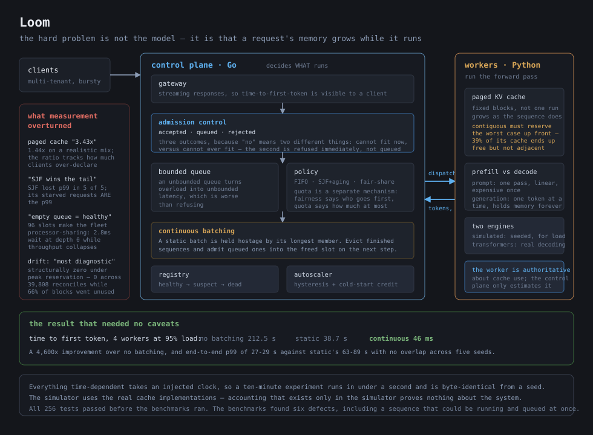

# 🧵 Loom

*An inference serving platform where the hard problem is not the model — and a benchmark suite that overturned both of its own headline claims.*



Loom is a control plane for LLM inference in **24,341 lines of Go and Python**, with **269 tests** — 162 Go (race-clean) and 107 Python — covering admission control, bounded queueing, three scheduling policies, paged KV-cache accounting, continuous batching, worker health and failure recovery, autoscaling with cold-start modelling, per-tenant quotas and fairness, and a Prometheus exporter. Zero dependencies outside each language's standard library, except an optional Hugging Face path for the real-model worker.

The thing I would actually put in front of someone is section 11 of [`bench/results.md`](bench/results.md), where the measurements **disagree with the people who wrote the code** — including me:

- The paged-cache advantage I had recorded as **3.43×** is 1.44× on a realistic workload. The number turns out to track how much clients over-declare their output ceiling, so quoting it bare states a workload property as a code property.
- The scheduling result recorded as *"the folklore is only half true"* is wrong: across five seeds SJF loses p99 **5 times out of 5**.
- My own comment claiming the autoscaler's signal is sufficient is false under continuous batching, where the queue stays empty while throughput collapses. That one is now fixed rather than just documented.
- The cache-drift metric I called "the most diagnostic number in the system" is **structurally always zero** under peak reservation — it read zero across 39,808 reconciles in a run that wasted two thirds of the cache.

**Ten genuine defects came out of the same exercise, all since fixed**, each with a test confirmed to fail before the fix. The worst was a correctness bug where a preempted sequence could end up running on a worker *and* sitting in the queue simultaneously, so two workers would generate the same request's tokens from the same prefix. Every one of the ten was found by measurement, not by testing: all 256 tests that existed before the benchmarks ran passed.

## ✨ Why I Built It

The naive mental model of inference serving is a queue in front of some GPUs, and it is wrong in a way that matters. Requests are not interchangeable units of work: a request's memory footprint **grows as it runs**, the resource it competes for cannot be oversubscribed the way CPU can, and the cost of a request is unknown until it finishes. A conventional scheduler built on that model will either leave the accelerator idle or run it out of memory mid-generation.

Two specifics I wanted to actually feel rather than recite:

**Prefill and decode are different workloads.** Processing a prompt is one compute-bound pass, roughly linear in prompt length. Generating is memory-bandwidth-bound and happens one token at a time, with the KV cache growing by one position per sequence per step. A long prompt is expensive once; a long generation is expensive forever and holds memory the whole time. Scheduling them identically is the central mistake.

**A static batch is held hostage by its longest member.** Put a 30-token and a 2000-token generation in one batch and the accelerator spends almost all its time computing one sequence at batch-of-eight cost. Continuous batching — evicting finished sequences and admitting queued ones into the freed capacity on the next step — is the fix, and the measured difference is not subtle.

## 🔭 What It Does

- **Admission control with three outcomes, not two.** `Accepted`, `Queued`, and `Rejected` — because "no" has two very different meanings. A request that cannot fit on any worker even when empty is refused *permanently* and immediately; one that cannot fit right now is queued. Every refusal carries a typed reason, so an operator can tell overload from a bad request.
- **Bounded queues, always.** An unbounded queue converts overload into unbounded latency, which is strictly worse than refusal: by the time the work completes the client has given up, so the capacity spent on it is pure waste *and* it delayed requests that were still useful.
- **Paged KV-cache accounting**, with a contiguous allocator implemented fairly alongside it so the comparison is real rather than rhetorical.
- **Continuous batching**, with a static batcher kept for the same reason.
- **Three scheduling policies** — FIFO, shortest-job-first with aging, and weighted fair-share on virtual time — plus per-tenant quotas, which are a *different* mechanism and the benchmarks show why.
- **A health state machine, not a boolean.** healthy → suspect → dead, because reaping on one missed heartbeat makes a GC pause look like a crash, and the cost of being wrong is failing every request on a perfectly good worker.
- **Worker failure that releases its reservations.** A worker loss that leaks capacity is invisible until the system stops admitting anything. Measured across every failure scenario: **zero leak in every row**.
- **An HTTP gateway** with streaming responses, so time-to-first-token is observable by a client rather than only in metrics.
- **Real Python workers** — a deterministic simulated engine for load experiments, and a Hugging Face path with genuine incremental decoding that degrades gracefully when torch is absent.

## 🧱 How I Built It

The boundary runs where the problem changes. Deciding *what* runs is a concurrency and resource-accounting problem, so it is Go. Running a forward pass is a Python and ML-runtime problem, so it is Python. They share only [`PROTOCOL.md`](PROTOCOL.md) — newline-delimited JSON over TCP, no generated code and no shared imports, so either half can be reasoned about and replaced independently. Putting the scheduler in the worker would mean one scheduler per worker, each with a partial view, which is how two workers come to believe they both have room for the same request.

**The cache is the interesting part.** A contiguous allocator must reserve a request's *worst case* up front, because its memory has to be one unbroken run and it cannot grow into space that may have been taken. Paging lets the reservation grow as the sequence actually does, and a finished sequence's blocks are immediately reusable by anyone. The contiguous version is implemented honestly — best-fit or first-fit, and its `Grow` really does extend into an adjacent free block when there is one — because beating a straw man proves nothing.

**The worker is authoritative about cache usage; the control plane only estimates.** The control plane predicts footprints to make admission decisions, then reconciles against the worker's report on every heartbeat. A scheduler that trusts its own prediction over a direct report drifts until it overcommits.

**Everything time-dependent takes an injected clock.** The health state machine, the autoscaler's hysteresis and cooldowns, and the whole simulator run on virtual time. A ten-minute experiment completes in under a second and is byte-identical from a seed. Real sleeps in a timing test are how a suite becomes flaky, and a flaky suite for this system would be useless.

**The simulator uses the real cache implementations.** Accounting that only exists in the simulator proves nothing about the system.

## 📊 What the Measurements Say

Measured on an Apple M4 Pro (14 cores, 48 GB), Go 1.27, virtual time, seeded and reproducible. Full output and reproduction commands in [`bench/results.md`](bench/results.md) and [`bench/README.md`](bench/README.md).

### Continuous batching is the single largest win

| 4 workers, FIFO, 95% load | Served/s | Tokens/s | TTFT p50 |
|---|---|---|---|
| No batching | 1.19 | 352 | **212.5 s** |
| Static batching | 2.93 | 870 | 38.7 s |
| **Continuous batching** | **3.96** | **1,177** | **46 ms** |

A **4,600× improvement in time-to-first-token** over no batching, and end-to-end p99 of 27–29 s against static batching's 63–89 s with no overlap across five seeds. This is the result that needed no caveats.

The batching *window* sweep (0→50 ms) is real for the continuous batcher — mean batch size 1.46→3.20 and 54% fewer forward passes for 12 ms more TTFT — and nearly useless for the static one, whose batch stayed pinned at 1.01 while TTFT rose from 29 to 83 ms. A window only pays when arrivals are closer together than the window and the batch is not already full.

### Bounded queues: the comparison that changed how I read latency numbers

| Queue cap, ρ=2.0 | Rejected | Served p50 | Served p99 |
|---|---|---|---|
| 32 | 42.1% | **7.1 s** | 38.8 s |
| 128 | 37.7% | 23.4 s | 54.2 s |
| 512 | 18.4% | 64.0 s | 114.3 s |
| unbounded | **0.0%** | **80.6 s** | 152.0 s |

Goodput is identical within 1.3% across all four. The unbounded queue refuses nobody and serves everyone in 81 seconds; the bounded one refuses 42% and serves the rest in 7. Which is better is a product decision, but they are not the same system, and reporting only "p50 latency" would make the bounded one look worse.

The time series is the real argument: bounded depth plateaus around 127 and **stops growing**; unbounded climbs monotonically to 857 and is still rising when arrivals stop. Which means — and the results file says this explicitly — **every unbounded percentile here is a statement about how long I chose to run the experiment**, not a property of the system. Run it twice as long and the bounded numbers are unchanged while the unbounded p99 roughly doubles.

### The paged-cache claim, corrected

I had recorded 3.43× (24 vs 7 concurrent sequences). Independently re-measured on a realistic three-tenant mix: **26 vs 18, a ratio of 1.44×**. Neither original figure reproduced.

| Declared-ceiling inflation | Paged / contiguous concurrency |
|---|---|
| 1× | 1.20× |
| 2× | 1.75× |
| 4× | 2.10× |
| 8× | 1.91× |
| 16× | 4.08× |

The ratio is essentially the factor by which a client's declared output ceiling exceeds its real generation length — which is exactly the quantity contiguous allocation must reserve and paging need not. 3.43× is reachable somewhere between 8× and 16× inflation. Quoting it without that context states a workload property as a code property.

The decomposition is more honest and more interesting. Holding reservation mode fixed, `paged+peak` gives 17 against `contiguous+peak`'s 18 — **paging alone buys no concurrency at all.** Almost the entire difference comes from the *reservation mode*, which paging makes possible rather than is. Paging's own direct contribution is fragmentation: **400 blocks, 39% of a 1024-block cache, free and unusable because they are not adjacent**, against a structural zero.

And the figure an operator would feel is neither — it is load shedding. At 8× inflation contiguous rejects **58.2%** of offered load for 226 tok/s; paged rejects **0.0%** for 583 tok/s, **2.6× the goodput**.

### Scheduling: the folklore is just true

At 110% load over five seeds, SJF wins p50 by 3.1–4.4× (1.18–1.64 s against FIFO's 2.37–7.26 s) — that half is decisive. But FIFO wins the max in 5 of 5, and **p99 went to fair-share in 4 seeds and FIFO in 1. SJF won p99 in zero of five.** FIFO's p99 range (32.6–36.3 s) sits entirely below SJF's (33.4–50.7 s).

The explanation is the output-length distribution: 5% of requests generate 600–1800 tokens against a median near 45, so **SJF's starved requests *are* the p99**, and no amount of good behaviour on the other 95% can hide them. Aging bounds the damage without removing it — wait-max 295 s → 169 s at ρ=1.5. Below saturation all four policies are indistinguishable, which is worth knowing before tuning one.

### Quota protects tenants; fair-share protects the adversary

At ρ=1.4 with an adversarial tenant sending 3000–7000-token prompts:

| | Adversary served | Chat served | Batch served |
|---|---|---|---|
| Neither | 77.4% | 78.8% | — |
| **Quota** | **6.3%** | **100%** | 100% |
| Fair-share alone | — | *worse* (43.1→61.7 s p50) | *worse* (53.5→65.7 s) |

Quota is what defends the other tenants. Fair-share *alone* improves the adversary's own p50 by 25× while making chat and batch worse — because fairness says who goes first, not how much anyone may have. They are different mechanisms and conflating them is a common mistake; here it is measured.

### Autoscaling buys cost, not latency

Under a ramp, a static 4-worker fleet gives wait p50 3.0 ms / p99 1.49 s. Autoscaled gives 4,320 ms / 15.9 s — far worse — while serving the identical 786 requests with 0% rejected and using **26% fewer worker-seconds** (800 vs 1080). The entire p99 is earned in the one 20-second window where two ordered workers are still cold. Hysteresis works as designed (5 up, 3 down over 4.5 minutes, not oscillation).

### Worker failure: no capacity leak, in any scenario

Killing 2 of 4 workers: **zero leak in every row**, 374–390 blocks correctly reported back by `ReapDead`. Retry off loses 10 requests; retry on loses 0 and the served count returns exactly to baseline, at the cost of a worse tail (p99 69.9 s vs 60.7 s) because the work is redone. Detection within 1.5 s. With autoscaler replacement, **recovery is 25 s** — 20 s cold start plus 1.5 s detection plus a 3 s sustained window — and wait p99 is 6.1× better than without.

## 📚 What I Learned

**The number I was proudest of was a property of my test data.** I recorded a 3.43× paged-cache win. Re-measured on a different workload it was 1.44×, and the sweep showed the ratio is basically the client's over-declaration factor. Nothing about the code changed between those two measurements. I now distrust any ratio I cannot reproduce on a workload I did not choose, and the decomposition — isolating the allocator from the reservation mode — is the thing I should have done first, because it showed paging's concurrency contribution is approximately nothing and its real contribution is 39% of the cache recovered from fragmentation.

**An empty queue is not evidence of health, and I wrote the opposite in a comment.** My `Autoscaler` contract said a fully utilized system with an empty queue "is working perfectly and needs nothing." Under continuous batching that is false: 96 concurrent slots make the fleet processor-sharing, so requests are admitted instantly and simply run slower. At 90% load the head-of-line wait reads 2.8 ms at depth zero while per-request throughput collapses. The queue forms only when slots run out, which makes the signal a cliff rather than a gradient — it arrives after the degradation it was supposed to predict. The fix is a slowdown term, not a better queue threshold, and the autoscaler now carries one: per-sequence tokens-per-second against an uncontended baseline, additive to queue wait so either signal can buy capacity. Its own weakness is named where it is implemented — the baseline is learned as a high-water mark, so a fleet saturated since startup learns its degraded rate as normal unless the baseline is configured.

**A metric can be structurally incapable of showing the problem it was built for.** I called estimate-versus-actual cache drift "the most diagnostic number in the system." Under peak reservation it is *identically zero*, because the worker can never exceed a worst-case reservation — zero across 39,808 reconciles in a run where **66% of reserved blocks were never touched**. A metric that reads perfect while two thirds of the cache is wasted is worse than no metric, because it actively argues that nothing is wrong. Waste needed its own measurement.

**Bounded versus unbounded taught me to distrust a latency number without a rejection rate.** The unbounded queue has a better rejection rate (zero) and a p50 eleven times worse. Worse, its percentiles are not properties of the system at all — the queue never reaches steady state, so every number is a function of how long I ran it. A p99 from a system that is still accumulating backlog is a measurement of my patience.

**Writing the naive alternative is what makes a result mean something.** This recurred everywhere: static batching next to continuous, contiguous next to paged, FIFO next to SJF, unbounded next to bounded. In every case the contrast carried the information and the absolute number carried almost none. It also kept me honest, because three of the four comparisons came out less flattering than I expected.

**Ten bugs came out of adversarial measurement, not from testing.** All 256 tests that existed at the time passed. The benchmarks found a sequence that could be simultaneously running on a worker and queued for dispatch, a reservation double-release, a silent 369-block leak, a fleet-wide scheduling stall nothing warned about, an autoscaler signal that fires after the damage, a feasibility check gating on a number no component was using, cold starts being misread as worker deaths, and four comments describing behaviour the code does not have.

Tests check what you thought to assert. A simulation pushing thousands of requests through the real components checks what you did not — and writing the test *first* for the worst of them taught me something extra: the bug could only be reproduced with a cache whose `Grow` serves a sequence holding nothing. With the paged cache the victim always gets re-preempted, so the defect surfaces only as a double report and never as the survival it actually is. The dangerous shape of a bug is not always the shape you first observe.

**The honest version of "preemption discards progress" is more interesting than the comment I wrote.** Four places in this repo said preemption throws away the victim's generated tokens. The code keeps them — and keeping them is *correct*, because it is the recomputation strategy real serving systems use: free the KV blocks and re-prefill prompt-plus-generated-tokens on reschedule. The comments were wrong, not the code, and the actual cost (re-prefilling a longer prompt) was accounted for nowhere.

## ⚖️ What I Do Not Claim

- **No GPU.** Everything runs on CPU, and the high-load experiments use a deterministic simulated engine because real inference is far too slow to drive a scheduler into overload. The simulated engine models prefill as linear in prompt length and decode as mildly superlinear in context; it uses the **real** cache implementations, but it is a model and the latency constants are not calibrated against hardware.
- **The real-model path is a correctness proof, not a performance one.** The Hugging Face worker does genuine incremental decoding with a real KV cache, which proves the end-to-end path works. Its 3 tests **skip** on this machine because torch is not installed.
- **The autoscaler's slowdown signal depends on a learned baseline.** It now scales on per-sequence throughput degradation as well as queue wait, which fixes the blindness under continuous batching. But the uncontended baseline is a high-water mark, so a fleet that has been saturated since startup learns its degraded rate as normal and the term goes quiet. Configuring the baseline avoids it; nothing detects it automatically.
- **Drift is uninformative under peak reservation** and is only meaningful under expected reservation. Documented in `PROTOCOL.md` now rather than left implicit.
- **Several results are too noisy to conclude from, and the results file says so per-cell.** Cache *goodput* overlaps between configurations (paged+expected 205–385 against contiguous 255–325). The paged+expected rejection rate ranges 3.7%–46.9% across seeds — a 12× spread, so any single number from that cell is meaningless. Best-fit and first-fit contiguous are indistinguishable.
- **One result points against paging and I cannot explain it away:** `paged+expected` has the best concurrency and best rejection rate but the *worst* goodput on the realistic mix, with 396 preemptions. Packing more sequences onto a worker makes every forward pass slower for all of them, and preemption discards work — but the preemption-cost accounting is also known to be wrong, so this is unresolved rather than understood.
- **Every preemption cost in the benchmarks is an underestimate**, because preemption retains generated tokens and the re-prefill cost of a longer prompt is not modelled.
- **The head-of-line stall is enforced per-decision, not per-placement.** `Queue.Pop()` is worker-agnostic, so the policy can decide *whether* to dispatch but not *where*. It now stops choosing work that only the congested worker could take, but nothing prevents a caller then placing that work there. Closing it needs `Pop`/`Next` to name the requesting worker.
- **The reservation-mode alignment does not reach the simulator.** It constructs policies directly and never calls `SetReservationMode`, so its feasibility check still gates on the peak. Only the real scheduler path is aligned — which also means the benchmark numbers are unchanged by that fix, and the preemption costs in `bench/results.md` remain underestimates because they were measured before resumed sequences were priced.
- **A worker dispatched to inside its first heartbeat window is still reaped on silence**, and counted as a failure, because its reservations have to come back. Fully closing that would mean warming workers are not dispatchable, which changes `Healthy()` semantics fleet-wide.
- **No multi-model workers, no model swapping, no speculative decoding, no prefix caching across requests, no disaggregated prefill/decode.** All real techniques, none implemented.
- **The gossip-free single control plane is a single point of failure.** No leader election, no replication of control-plane state.
- **The HTTP gateway has no authentication and no TLS.**

## 🛠️ Tech Stack

- **Go 1.27** for the control plane — standard library only. Hand-rolled Prometheus text exporter with real bucketed histograms, because an average hides exactly the overload behaviour this project exists to show.
- **Python 3.12** for workers — standard library only, with `torch`/`transformers` as an optional path that must not break the import when absent.
- **Injected clocks and seeded RNGs throughout**, so the simulator is byte-reproducible and the timing tests are not flaky.
- **Newline-delimited JSON over TCP** between the halves, hand-specified in `PROTOCOL.md`.
- Hand-written SVG for the diagram.

## 🚀 Setup

**Prerequisites.** Go 1.22+ and Python 3.10+. `torch` and `transformers` are optional.

1. **Build and test.**
   ```sh
   git clone https://github.com/LegendaryPenguin/loom.git
   cd loom
   go build ./... && go test -race ./...
   python3 -m unittest discover -s python-worker/tests
   ```
   The `bench` package takes about four minutes; it is the experiment suite.

2. **Run a control plane and a worker.**
   ```sh
   go run ./cmd/loom-control-plane -http-addr :8080 -worker-addr :9090 -policy sjf -batcher continuous &

   # loom_worker lives under python-worker/, so it is not importable from the repo root
   PYTHONPATH=python-worker python3 -m loom_worker \
       --addr 127.0.0.1:9090 --model tiny-gpt2 --simulated --blocks 256
   ```

3. **Send a request, streaming, so time-to-first-token is visible.**
   ```sh
   curl -N -H 'X-Loom-Tenant: demo' -d '{"prompt":"the cairn marks","max_output_tokens":64}' \
     http://127.0.0.1:8080/v1/generate
   curl -s http://127.0.0.1:8080/metrics | grep loom_
   ```

4. **Reproduce the experiments.** See [`bench/README.md`](bench/README.md).
   ```sh
   go test ./bench/ -run TestExpBatching -v
   go test ./bench/ -run TestExpCache -v
   go test ./bench/ -run TestExpQueueBound -v
   ```

## 🗺️ Repository Map

| | |
|---|---|
| [`PROTOCOL.md`](PROTOCOL.md) | the Go↔Python contract — **start here** |
| [`go-control-plane/contracts.go`](go-control-plane/contracts.go) | the interfaces, and the reasoning behind each |
| [`go-control-plane/cache.go`](go-control-plane/cache.go) | paged and contiguous KV-cache accounting |
| [`go-control-plane/admission.go`](go-control-plane/admission.go) | cost estimation, quotas, reservation modes |
| [`go-control-plane/batcher.go`](go-control-plane/batcher.go) | static and continuous batching |
| [`go-control-plane/policy.go`](go-control-plane/policy.go) | FIFO, SJF with aging, weighted fair-share |
| [`go-control-plane/registry.go`](go-control-plane/registry.go) | health state machine, reaping, retry classification |
| [`python-worker/`](python-worker/) | the simulated and real engines |
| [`simulator/`](simulator/) | virtual-time fleet simulation |
| [`bench/results.md`](bench/results.md) | **the measurements, including section 11** |

Licensed under [MIT](LICENSE).
